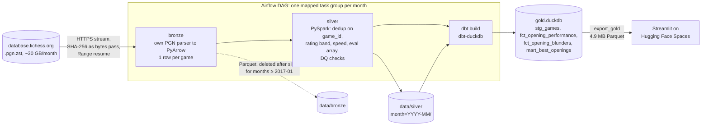

# Opening Finder

Enter your Lichess rating, time control and colour; get the openings that score best for players like you, plus the opening families where players at your level blunder most.

**Live demo:** _link added once the Space is deployed_

Built from 273 million rated games in the Lichess open database (2013-01 to 2013-06 and 2024-08 to 2024-10), parsed from the raw `.pgn.zst` dumps by a streaming parser written for this project.

## How it works



| Layer | What it does | Tool |
|---|---|---|
| Bronze | Streams one month from Lichess, never touching disk uncompressed, and writes one Parquet row per game with typed headers and raw movetext | own parser over `zstandard`, PyArrow |
| Silver | Dedups on `game_id`, derives rating band (average Elo, floor 100), speed from `TimeControl`, opening family, per-ply evals in centipawns; checks row counts and nulls on the staged output before swapping it in | PySpark 3.5 |
| Gold | Opening performance by band × speed × colour, Wilson lower bound on score, blunders per game by phase from analysed games only | dbt-core + dbt-duckdb, 47 tests |
| Orchestration | One DAG, `months` param, dynamic task mapping per month, idempotent partition overwrite | Airflow 3 (docker-compose) |
| Demo | Reads the exported gold Parquet into pandas | Streamlit, Docker Space |

Openings are ranked by the **Wilson lower bound** on score, not by raw score, so an opening with 12 games at 75% can't outrank one with 40,000 games at 56% (D-007). Lines need at least 100 games in a slice to be ranked (D-024).

Every non-obvious choice is written up, with the options considered and what would change it, in [decisions.md](decisions.md).

### Why parse PGN when Lichess publishes Parquet?

Lichess also publishes these games as Parquet on Hugging Face. Starting there would skip the hard part: ingesting a non-splittable, semi-structured 30 GB stream on one laptop. This project parses the raw dumps and uses the Hugging Face copy only as an independent cross-check of row counts and aggregates (D-001).

## Benchmarks

All on one Apple M4 laptop (10 cores, 16 GB RAM). Full tables, commands and caveats are in [benchmarks/results.md](benchmarks/results.md).

| What | Result |
|---|---|
| Parser, one core | 61,260 games/s on 2013 (python-chess: 1,908/s, 32× slower); 37,437 games/s on 2024 games with clock and eval comments; 33–90 MB RSS |
| One 2024 month end to end | 28.6 GB compressed, 87.7M games. Bronze 5.1 h (network-bound: parser at ~25% of one core), silver 9.6 min. Peak disk 47 GB, 4.2 GB kept |
| Three 2024 months | 89.4 GB streamed, 274M games, 13.3 GB silver kept. Cost per month flat: 47–51 GB peak disk, under 720 MB RSS |
| Process-pool parser | Tops out at 2.3× with 4 workers (single parent decompresses and pickles). Not wired in: the link delivers ~2 MB/s, the single-process parser handles 11 MB/s |
| DuckDB vs Spark `local[*]`, gold aggregation | DuckDB 8–11× faster on 2013 data; 4.6× on one 2024 month (4.3 s vs 19.9 s); 4.9× on three months, 274M rows (10.3 s vs 50.8 s) |
| File sizing, one 2024 month | 5,020 files of 0.9 MB vs 63 of 109 MB: 2× slower Spark write, 3.3× slower Spark narrow query, 2.5× slower DuckDB narrow query. Flat from ~8 MB up |
| Skew, join on `opening_family`, one 2024 month | Hot partition 151 MB. AQE skew join fires only with lowered thresholds (256 MB default): longest task 9.2 s → 0.47 s, join 17.9 s → 11.0 s. Salting worse (25.0 s). Broadcasting the 147-row lookup wins: 6.1 s |
| dbt build, 9 months | 70 s, after rewriting the blunder model from unnest + join (584 s, 30 GB spill) to a per-game list lambda (26 s) |

## Run it locally

Needs Python 3.11 and [uv](https://docs.astral.sh/uv/). Spark needs a JDK 17 (`JAVA_HOME`).

```bash
uv sync
uv run pytest
```

The demo runs from the gold export committed under `app/data/`; no pipeline run is needed:

```bash
uv run streamlit run app/streamlit_app.py
```

To rebuild everything for one month:

```bash
uv run python -m lichess.bronze --month 2013-02
```

```bash
uv run python -m lichess.spark_jobs.silver_games --month 2013-02
```

```bash
mkdir -p data/gold && uv run dbt build --project-dir dbt --profiles-dir dbt
```

```bash
uv run python -m lichess.export_gold
```

Or through Airflow (UI at http://localhost:8080):

```bash
docker compose up -d --build
```

```bash
docker compose exec airflow-scheduler airflow dags trigger lichess_pipeline --conf '{"months": ["2013-01","2013-02"]}'
```

## Limits

- **Blunder numbers come from analysed games only:** 25M of the 273M games, which players chose to send for computer analysis. That is a self-selected sample and is labelled as such in the app (D-008).
- **An opening's name is the position the game reached, not who chose it.** As Black, many top rows are White's choices (for example the Bongcloud). The app says so.
- **Rating band is the two players' average Elo**, so "1200" means games where the average was 1200–1299, not games where you are 1200 against anyone.
- **Two eras, unevenly weighted:** 2024 months are 99.6% of the games. Rankings reflect current Lichess play.

## Layout

```
dags/            Airflow DAG
src/lichess/     parser, bronze writer, Spark silver job, gold export
dbt/             staging and mart models, tests, docs
app/             Streamlit demo, its Dockerfile and the exported gold data
benchmarks/      benchmark scripts and results.md
tests/           pytest, with hand-written PGN fixtures
decisions.md     decision log
```
